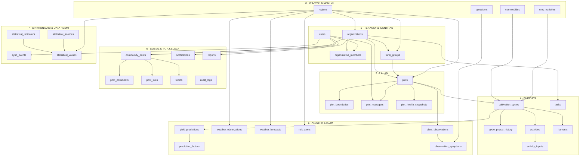
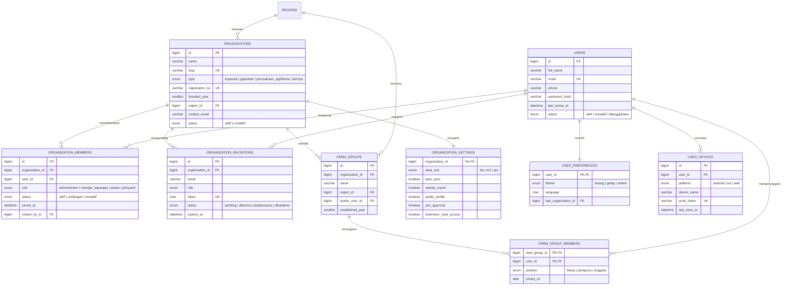
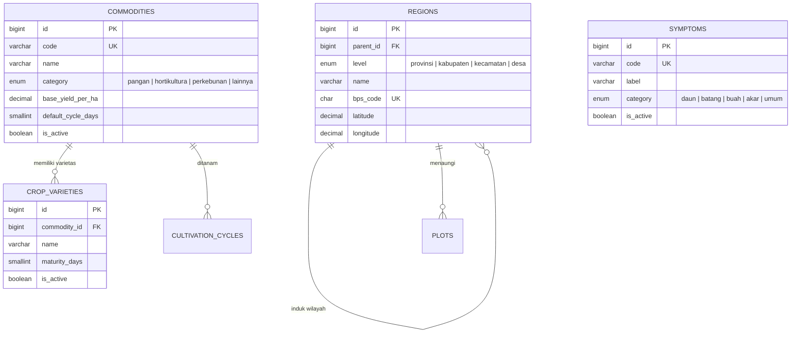
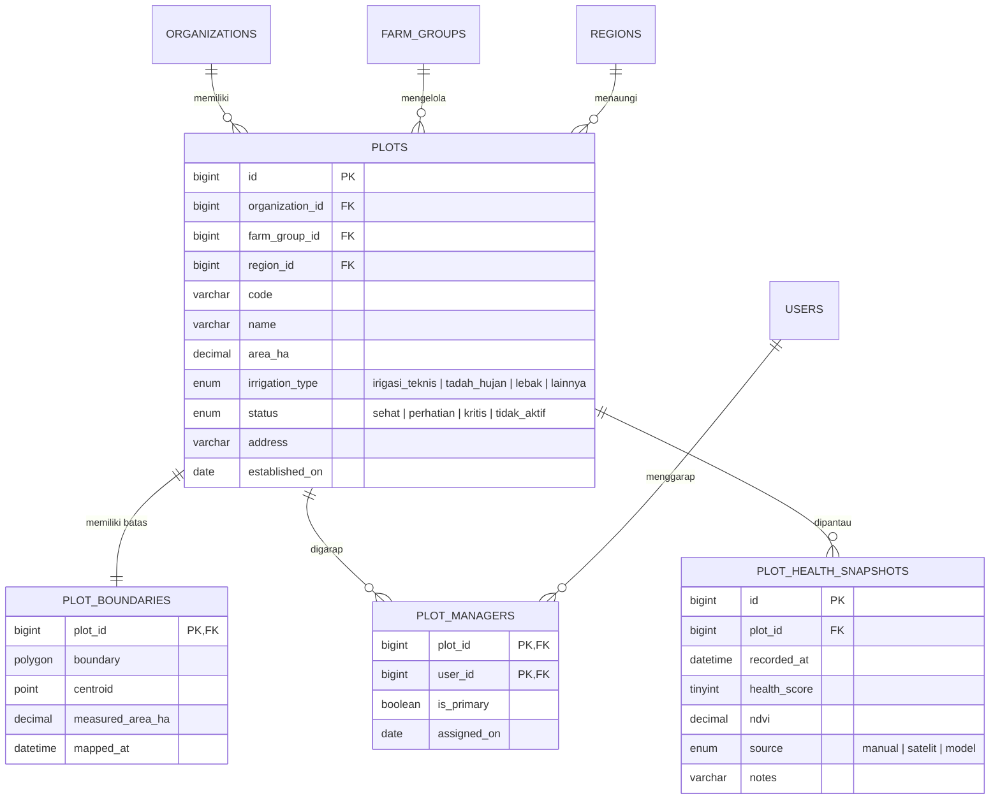
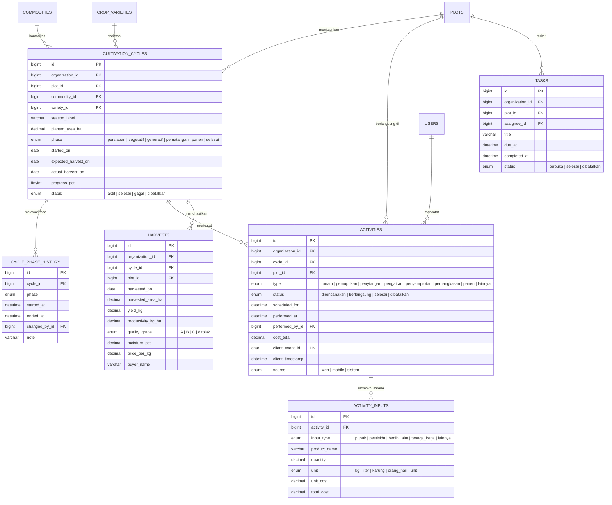
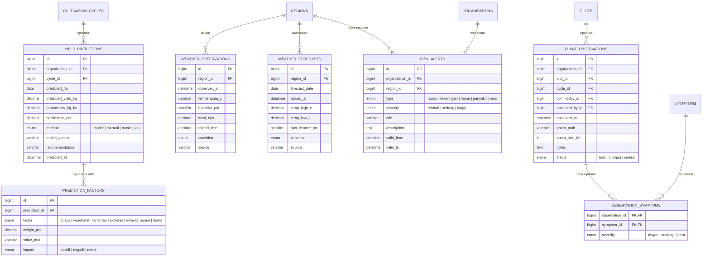
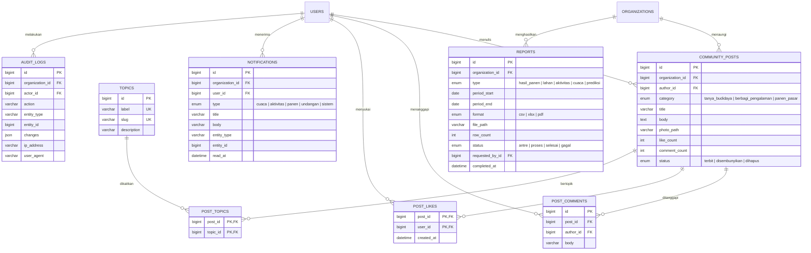
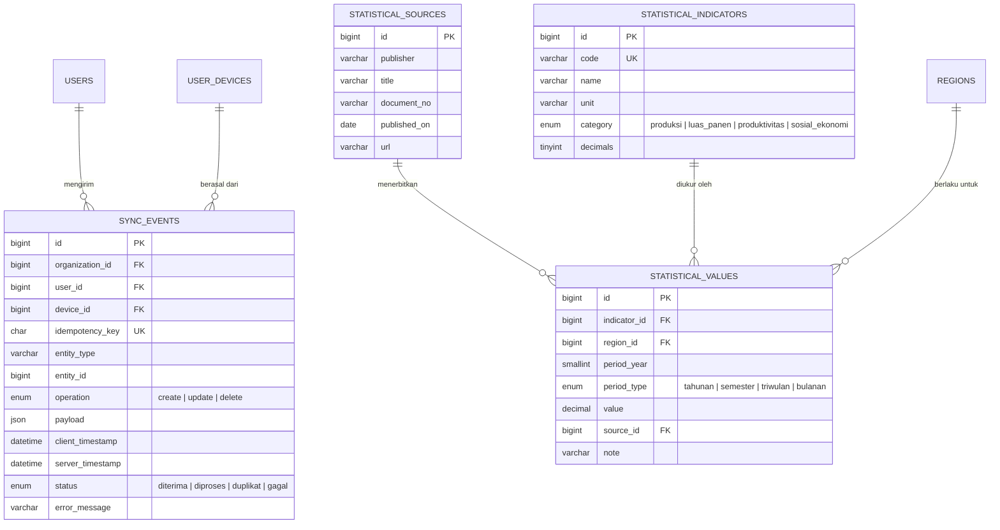

# 01 · ERD MAPAN

Semua diagram memakai notasi *crow's foot* (Mermaid). Nama entitas = nama tabel sebenarnya.

**Legenda kardinalitas**

| Simbol | Arti |
| :--- | :--- |
| `||--||` | satu ke satu (wajib) |
| `||--o{` | satu ke banyak (boleh nol) |
| `||--|{` | satu ke banyak (minimal satu) |
| `}o--o{` | banyak ke banyak |

Kunci: `PK` primary key, `FK` foreign key, `UK` unique key. Kolom audit (`created_at`, `updated_at`, `deleted_at`) tidak diulang di setiap diagram agar terbaca; semuanya ada di kamus data.

---

## 1. Gambaran Konseptual

### 1.1 Relasi lintas domain

Relasi yang "menyeberang" domain dan perlu diperhatikan saat membuat DDL:

| Dari | Ke | Arti |
| :--- | :--- | :--- |
| `organizations.region_id` | `regions` | Wilayah operasional koperasi |
| `farm_groups.region_id` | `regions` | Wilayah kelompok tani |
| `plots.region_id` | `regions` | Lokasi administratif petak (dasar agregasi cuaca) |
| `plots.organization_id` | `organizations` | Kepemilikan tenant |
| `plots.farm_group_id` | `farm_groups` | Kelompok tani pengelola |
| `cultivation_cycles.plot_id` | `plots` | Siklus berjalan di petak |
| `activities.performed_by_id` | `users` | Petani pencatat |
| `plant_observations.cycle_id` | `cultivation_cycles` | Opsional: scan bisa tanpa siklus |
| `community_posts.organization_id` | `organizations` | `NULL` = diskusi lintas organisasi |
| `statistical_values.region_id` | `regions` | `NULL` = angka nasional |

---

## 2. Domain 1 — Tenancy & Identitas

### Catatan desain

- **`organization_members` adalah jantung isolasi tenant.** `role` ada di sini, bukan di `users`. Satu user bisa punya baris berbeda di dua organisasi dengan peran berbeda. Ini yang membuat `UNIQUE (organization_id, user_id)` penting: satu orang hanya boleh punya satu peran per organisasi.
- **`organization_settings` dan `user_preferences` dipisah** karena pemiliknya berbeda: setelan organisasi diubah admin dan berlaku untuk semua anggota; tema terang/gelap milik masing-masing pengguna. Menggabungkannya akan melanggar 3NF (atribut bergantung pada dua subjek).
- **`user_preferences.last_organization_id`** menyimpan organisasi terakhir yang dipilih sehingga pemilih organisasi di sidebar langsung terbuka di konteks yang benar.
- **`organization_invitations` tidak memakai `user_id`** karena undangan dikirim ke alamat email yang belum tentu punya akun.
- **`user_devices.push_token` unik** agar satu perangkat tidak menerima notifikasi ganda; token FCM lama dicabut dengan `revoked_at`.

---

## 3. Domain 2 — Wilayah & Master

### Catatan desain

- **`regions` mereferensi dirinya sendiri** (`parent_id`) untuk hierarki provinsi → kabupaten → kecamatan → desa. Ini menghindari empat kolom teks berulang di `plots` dan memungkinkan agregasi cuaca per kecamatan seperti yang diminta dokumen lama §7.
- **`bps_code`** memungkinkan pencocokan otomatis dengan tabel BPS, sehingga data statistik dan data operasional memakai kode wilayah yang sama.
- **`commodities.base_yield_per_ha`** adalah koefisien *BaseYield* pada rumus prediksi dokumen lama §5.
- **`symptoms` hanya master gejala, bukan penyakit.** UI menyatakan diagnosis otomatis belum tersambung, jadi menyimpan tabel penyakit akan menjadi tabel kosong tanpa pemakai.
- `regions.level` sengaja `ENUM`, bukan tabel lookup: kedalaman hierarki administratif Indonesia sudah baku dan tidak akan ditambah admin.

---

## 4. Domain 3 — Lahan

### Catatan desain

- **`plot_boundaries` terpisah dari `plots`** karena dua alasan: (1) MySQL mewajibkan kolom `SPATIAL INDEX` bersifat `NOT NULL`, sedangkan batas lahan sering belum dipetakan saat pendaftaran; (2) poligon hanya dibutuhkan halaman Peta, sehingga tabel `plots` tetap ringan untuk query daftar.
- **`plot_managers.is_primary`** menjawab kebutuhan UI yang menampilkan satu "Petani pengelola", tanpa membatasi satu petak hanya boleh satu petani. Dijaga oleh *generated column* + `UNIQUE` (lihat `03-normalisasi-dan-aturan.md`).
- **`plot_health_snapshots` menyimpan riwayat**, bukan satu kolom `health` di `plots`. Angka `94%` di UI adalah snapshot terbaru; tren kesehatan butuh seri waktu.
- **`plots.status`** (`sehat`/`perhatian`) adalah status operasional yang diubah manusia atau mesin, sedangkan `health_score` adalah hasil pengukuran. Keduanya sengaja tidak digabung: status bisa diturunkan dari skor, tetapi tidak selalu (mis. lahan sengaja diistirahatkan).
- **`measured_area_ha`** menyimpan hasil hitung `ST_Area` dari poligon. Bila berbeda dengan `plots.area_ha` (yang diisi manual), selisihnya bisa ditinjau — ini kasus nyata di lapangan.

---

## 5. Domain 4 — Budidaya

### Catatan desain

- **Fase ada di dua tempat dengan peran berbeda.** `cultivation_cycles.phase` adalah fase *saat ini* (dipakai papan kanban dan filter); `cycle_phase_history` adalah jejak perpindahan fase. Menyimpan hanya yang pertama akan menghilangkan riwayat; menyimpan hanya yang kedua membuat setiap query papan butuh subquery. Keduanya dijaga konsisten oleh aplikasi dalam satu transaksi.
- **`activities` menyimpan `organization_id`** meskipun bisa diturunkan dari `plot_id`. Ini denormalisasi yang disengaja agar setiap query tenant bisa memakai satu indeks berawalan `organization_id` tanpa join. Lihat justifikasinya di `03-normalisasi-dan-aturan.md` §7.1.
- **`client_event_id` unik** adalah kunci idempotensi untuk replay offline. Aktivitas yang dikirim ulang dari antrean mobile akan ditolak oleh `UNIQUE`, bukan menghasilkan duplikat.
- **`activity_inputs` menormalisasi bahan yang dipakai.** Satu aktivitas pemupukan bisa memakai urea dan NPK sekaligus — inilah alasan tabel anak, bukan kolom teks "jenis pupuk".
- **`harvests.productivity_kg_ha` adalah *generated column*** (`yield_kg / harvested_area_ha`), bukan input manual, sehingga tidak mungkin tidak sinkron dengan komponennya.
- **`harvests` menyimpan `plot_id` selain `cycle_id`** agar laporan per petak tetap jalan walaupun siklusnya nanti dihapus/diarsipkan. Konsistensi keduanya dijaga trigger atau validasi aplikasi (bukan `CHECK`, karena `CHECK` MySQL tidak bisa membaca tabel lain).
- **`activities.cycle_id` boleh `NULL`** untuk kegiatan yang belum terikat siklus (mis. perbaikan saluran air). Kolom `plot_id` tetap wajib.

---

## 6. Domain 5 — Analitik & Iklim

### Catatan desain

- **`yield_predictions` banyak baris per siklus.** Dokumen lama memasang `UNIQUE` pada `planting_cycle_id`, sehingga prediksi baru menimpa yang lama dan riwayat evaluasi model hilang. Di sini setiap perhitungan adalah baris baru; UI mengambil yang terbaru lewat `ROW_NUMBER()`.
- **`prediction_factors` memecah `weather_snapshot JSONB`** dari dokumen lama menjadi baris terstruktur. Dengan begitu pertanyaan "faktor apa yang paling menurunkan prediksi bulan ini?" bisa dijawab SQL, bukan parsing JSON di aplikasi.
- **Cuaca diukur per `region_id`, bukan per petak.** Sesuai mitigasi risiko dokumen lama §7 (rate limit API): satu kecamatan punya banyak petak, cukup satu deret cuaca. Petak terhubung ke cuaca lewat `plots.region_id`.
- **`weather_forecasts` menyimpan `issued_at`.** Prakiraan yang sama untuk tanggal yang sama bisa direvisi; `UNIQUE (region_id, forecast_date, issued_at)` menyimpan revisinya sebagai riwayat.
- **`risk_alerts.organization_id` boleh `NULL`** untuk peringatan tingkat wilayah yang berlaku bagi semua organisasi di daerah itu.
- **`ENUM severity` sengaja berurutan `rendah → sedang → tinggi`** agar `MAX(severity)` mengembalikan tingkat paling berat sesuai urutan indeks ENUM, bukan urutan abjad.
- **Tidak ada tabel diagnosis.** Lihat Domain 2.

---

## 7. Domain 6 — Sosial & Tata Kelola

### Catatan desain

- **`post_likes` memakai kunci komposit `(post_id, user_id)`**, bukan tabel dengan `id` sendiri. Ini menjamin secara struktural bahwa satu pengguna hanya bisa menyukai satu diskusi sekali — tidak perlu validasi aplikasi.
- **`like_count` dan `comment_count` adalah cache.** Sumber kebenaran tetap `COUNT(*)` pada tabel anak. Keduanya wajib diperbarui trigger; kalau tidak, angka di UI akan menyimpang. Justifikasi lengkap ada di dokumen 03 §7.2.
- **`community_posts.organization_id` boleh `NULL`** untuk diskusi lintas koperasi — sesuai teks UI "248 petani terhubung … dari berbagai wilayah".
- **`topics` dipisah dari `post_topics`** karena satu diskusi bisa punya beberapa topik, dan panel "Topik populer" menghitung jumlah diskusi per topik.
- **`reports` menyimpan riwayat ekspor**, bukan hanya tombol unduh. UI sudah menampilkan "Berkas terbaru" dan "Siap dibuka", yang butuh status dan path file.
- **`audit_logs.changes` bertipe `JSON`** karena bentuk perubahannya berbeda per entitas. Ini satu-satunya tempat JSON dipakai untuk data yang tidak di-query langsung — bukan alasan untuk mem-JSON-kan tabel lain.
- **`notifications.entity_type` + `entity_id`** adalah relasi polimorfik (bisa menunjuk ke siklus, petak, atau laporan). Tidak bisa diberi FK sungguhan; validitasnya dijaga aplikasi. Ini kompromi yang didokumentasikan, bukan kelalaian.

---

## 8. Domain 7 — Sinkronisasi & Data Resmi

### Catatan desain

- **`idempotency_key` unik di tingkat tabel** (bukan hanya per batch) sehingga replay dari perangkat mana pun tetap ditolak bila event yang sama sudah pernah diproses. Ini implementasi langsung dari strategi dokumen lama §4.
- **`payload` menyimpan isi asli dari klien.** Kalau terjadi kegagalan pemetaan ke tabel tujuan, isinya masih bisa direplay manual tanpa meminta petani mengulang pencatatan.
- **`status='duplikat'` dicatat, bukan dibuang.** Tim ops bisa melihat berapa banyak pengiriman ulang terjadi — indikator kesehatan jaringan di lapangan.
- **`statistical_values` memakai `region_id` nullable**: `NULL` berarti angka nasional (mis. produksi padi Indonesia 53,14 juta ton), terisi berarti angka provinsi (mis. Jawa Timur 9,27 juta ton). Satu tabel melayani kedua tingkat.
- **`statistical_values` memakai `DECIMAL(18,4)`** agar angka BPS seperti 52,88 kuintal/ha dan 29,36 juta unit tidak kehilangan presisi.

---

## 9. Ringkasan Kardinalitas Penting

| Relasi | Kardinalitas | Konsekuensi implementasi |
| :--- | :--- | :--- |
| User ↔ Organisasi | banyak ke banyak | Tabel pivot `organization_members` + `UNIQUE(org, user)` |
| Organisasi → Petak | satu ke banyak | `organization_id` di `plots`, indeks komposit |
| Petak ↔ Petani | banyak ke banyak | `plot_managers` + aturan satu `is_primary` |
| Petak ↔ Siklus | satu ke banyak, tapi satu aktif | *Generated column* + `UNIQUE` |
| Siklus → Aktivitas | satu ke banyak | Indeks `(cycle_id, performed_at)` |
| Aktivitas → Sarana | satu ke banyak | `activity_inputs` (1NF) |
| Diskusi ↔ Penyuka | banyak ke banyak | PK komposit `(post_id, user_id)` |
| Wilayah → Cuaca | satu ke banyak | Indeks `(region_id, observed_at DESC)` |
| Organisasi → Statistik | tidak langsung | Statistik bersifat publik, tidak memiliki `organization_id` |

---

## 10. Geometri: Keputusan Spasial

| Aspek | Keputusan |
| :--- | :--- |
| Sistem referensi | `SRID 4326` (WGS 84), sesuai GPS ponsel petani |
| Penyimpanan | `POLYGON` untuk batas, `POINT` untuk titik pusat |
| Indeks | `SPATIAL INDEX` pada `boundary` dan `centroid` |
| Luas | `ST_Area(boundary)` mengembalikan **meter persegi** untuk SRS geografis (MySQL ≥ 8.0.13); bagi 10.000 untuk hektare, simpan di `measured_area_ha` |
| Titik pusat | `ST_Centroid()` **tidak didukung** untuk SRS geografis di MySQL 8.0; hitung lewat proyeksi UTM lalu `ST_Transform` kembali, atau hitung di aplikasi |
| Query viewport peta | Saring dengan `MBRContains` pada `centroid` (murah), lalu ambil `ST_AsGeoJSON(boundary)` hanya untuk petak yang lolos |
| Validasi | Tolak poligon yang memotong dirinya sendiri (`ST_IsValid`) sebelum `INSERT` |

### 10.1 Tiga jebakan spasial MySQL yang harus diingat saat DDL ditulis

1. **Satuan `ST_Area` adalah meter persegi, bukan derajat.** Dokumentasi MySQL 8.0 menyatakan bahwa poligon valid pada SRS geografis menghasilkan *geodetic area* dalam **m²**. Jadi 1 hektare = 10.000 m². Ini berbeda dari PostGIS, yang mengembalikan derajat persegi bila kolomnya bertipe `geometry` (bukan `geography`). Karena proyek ini berpindah dari PostgreSQL ke MySQL, kesalahan konversi justru mudah terjadi di sini.
2. **`ST_Centroid()` menolak SRS geografis.** MySQL melempar `ER_NOT_IMPLEMENTED_FOR_GEOGRAPHIC_SRS`. Karena itu `centroid` tidak boleh diisi lewat `ST_Centroid(boundary)` langsung. Pola yang aman: `ST_Transform(ST_Centroid(ST_Transform(boundary, 32751)), 4326)` untuk zona UTM 51S (Jawa Timur/Bali), atau hitung di aplikasi.
3. **Urutan sumbu `SRID 4326` adalah (lat, lon), sedangkan GeoJSON adalah (lon, lat).** MySQL menghormati definisi sumbu SRS, sehingga WKT/`ST_GeomFromText` untuk 4326 menerima `POINT(latitude longitude)`. Kalau klien Leaflet mengirim `[lat, lng]` lalu disimpan tanpa penyesuaian, petak akan muncul di lokasi yang salah. Standarkan konversi di satu tempat (adapter API), bukan tersebar di beberapa endpoint.
