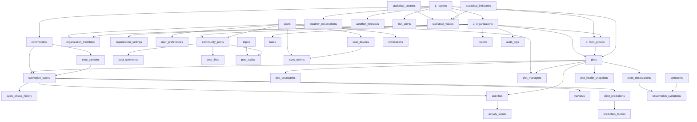

# 05 · Rencana Implementasi

Dokumen ini mengatur urutan pembuatan skema, hal yang harus diputuskan sebelum DDL ditulis, dan cara memverifikasi bahwa hasilnya benar.

---

## 1. Urutan Dependensi

Tabel harus dibuat mengikuti arah foreign key. Membuat `activities` sebelum `plots` akan gagal.

Lapisan yang tidak saling bergantung (`topics`, `symptoms`, `statistical_*`) boleh dibuat kapan saja.

---

## 2. Tahapan

### Fase 0 — Persetujuan rancangan

**Keluaran:** dokumen 00–05 disetujui.
**Kriteria selesai:** tidak ada perubahan nama tabel/kolom setelah fase ini tanpa alasan tertulis.

### Fase 1 — Fondasi tenant & master (13 tabel)

`regions`, `organizations`, `users`, `organization_members`, `organization_invitations`, `farm_groups`, `farm_group_members`, `organization_settings`, `user_preferences`, `user_devices`, `commodities`, `crop_varieties`, `symptoms`

**Membuka:** login, pemilih organisasi, halaman Pengguna, Organisasi, Pengaturan.

**Titik rawan:** hierarki `regions` butuh data awal wilayah. Untuk demo, cukup 1 provinsi → 1 kabupaten → 2 kecamatan; jangan mengimpor seluruh Indonesia sebelum skema stabil.

### Fase 2 — Lahan & spasial (4 tabel)

`plots`, `plot_boundaries`, `plot_managers`, `plot_health_snapshots`

**Membuka:** halaman Lahan, Peta lahan, kartu "Total lahan" dan "Kesehatan".

**Titik rawan:** konversi luas poligon (lihat §4 R-01). Uji dengan satu poligon yang luasnya sudah diketahui manual.

### Fase 3 — Budidaya (6 tabel)

`cultivation_cycles`, `cycle_phase_history`, `activities`, `activity_inputs`, `harvests`, `tasks`

**Membuka:** Siklus budidaya, aktivitas, panen, panel Tugas.

**Titik rawan:** `active_guard` dan `primary_guard` adalah *generated column*; pastikan versi MySQL mendukung `IF()` dan `CONCAT()` di generated column (8.0 mendukung), dan buat **`VIRTUAL`** bukan `STORED` bila kolom dasarnya memakai `ON DELETE CASCADE` (R-11).

### Fase 4 — Analitik & iklim (7 tabel)

`yield_predictions`, `prediction_factors`, `weather_observations`, `weather_forecasts`, `risk_alerts`, `plant_observations`, `observation_symptoms`

**Membuka:** Prediksi panen, Cuaca & risiko, Scan tanaman.

**Titik rawan:** data cuaca adalah tabel terbesar. Jangan mengisi data historis panjang sebelum partisi diputuskan.

### Fase 5 — Sosial, laporan, sinkronisasi (9 tabel)

`topics`, `community_posts`, `post_comments`, `post_likes`, `post_topics`, `notifications`, `reports`, `audit_logs`, `sync_events`

**Membuka:** Komunitas, notifikasi topbar, Laporan, antrean offline.

**Titik rawan:** trigger `like_count`/`comment_count` harus diuji dengan hapus-suka berulang agar tidak menghasilkan angka negatif.

### Fase 6 — Data resmi BPS (3 tabel)

`statistical_sources`, `statistical_indicators`, `statistical_values`

**Membuka:** grafik halaman Tentang yang sebelumnya hardcode di `agriculture.js`.

**Titik rawan:** UK dengan `region_id` nullable (lihat §4 R-03).

---

## 3. Data Awal (Seed) Minimum

Agar aplikasi bisa didemokan tanpa data palsu yang berantakan:

| Kelompok | Isi minimum |
| :--- | :--- |
| Wilayah | Bali → Tabanan → 2 kecamatan; cukup untuk seluruh contoh UI |
| Komoditas | Padi, Jagung, Cabai, Tomat, Kopi |
| Varietas | Padi: Inpari 32, Ciherang; Jagung: Hibrida |
| Gejala | 4 gejala yang sudah ada di UI |
| Organisasi | Koperasi Subak Sari (data profil sesuai UI) |
| Pengguna | 1 admin, 1 manajer lapangan, 3 petani, 1 penyuluh |
| Kelompok tani | 6 nama yang sudah tampil di UI |
| Petak | 6 petak contoh dengan luas dan status yang konsisten |
| Siklus | 6 siklus mengikuti fase di papan kanban |
| Statistik BPS | Seri padi 2019–2024, jagung 2024, sensus 2023, 5 provinsi 2024 |

Data seed harus **konsisten secara angka**: total luas 6 petak harus sama dengan angka "total lahan" yang ditampilkan. Kalau seed-nya sendiri tidak konsisten, pengujian query tidak ada artinya.

---

## 4. Risiko Teknis

| # | Risiko | Dampak | Mitigasi |
| :-- | :--- | :--- | :--- |
| R-01 | `ST_Area` pada SRS geografis mengembalikan **m²**, bukan hektare; MySQL < 8.0.13 melempar error | Luas lahan meleset 10.000× atau query gagal | Bagi 10.000 sebelum disimpan; syaratkan MySQL ≥ 8.0.13; uji dengan poligon 100 m × 100 m yang seharusnya ±1 ha |
| R-02 | Tidak ada RLS di MySQL | Kebocoran data antar koperasi | `organization_id` wajib diisi dari sesi; test otomatis yang mencoba mengakses data organisasi lain harus gagal |
| R-03 | `UNIQUE` menganggap `NULL` berbeda | Duplikat angka nasional BPS | Tambahkan `region_key` generated `IFNULL(region_id, 0)` dan UK memakai kolom itu |
| R-04 | `DATETIME` tidak menyimpan zona waktu | Aktivitas tercatat di jam yang salah | Simpan UTC; konversi ke WIB hanya di lapisan tampilan |
| R-05 | `ENUM` sulit diubah | Menambah fase/status butuh `ALTER TABLE` | Fase dan status sengaja dibatasi karena UI juga mengunci daftarnya; jika kelak perlu dinamis, migrasikan ke tabel lookup |
| R-06 | Trigger counter bisa menghasilkan angka negatif | `like_count` tidak masuk akal | Trigger `DELETE` memakai `GREATEST(count - 1, 0)`; job rekonsiliasi mingguan |
| R-07 | Partisi belum diperlukan di awal | Kompleksitas tanpa manfaat | Tunda partisi sampai volume `weather_observations` melewati ±2 juta baris |
| R-08 | Data seed tidak konsisten dengan KPI | Demo terlihat benar padahal query salah | Turunkan KPI sepenuhnya dari query, jangan pernah hardcode di frontend |
| R-09 | `ST_Centroid()` tidak didukung untuk SRS geografis (`ER_NOT_IMPLEMENTED_FOR_GEOGRAPHIC_SRS`) | Kolom `centroid` tidak bisa diisi lewat SQL langsung | Hitung lewat proyeksi UTM (`ST_Transform` → `ST_Centroid` → `ST_Transform` balik) atau hitung di aplikasi |
| R-10 | Urutan sumbu `4326` di MySQL adalah (lat, lon), sedangkan GeoJSON (lon, lat) | Petak tampil di lokasi yang salah, bisa di tengah laut | Satu adapter konversi di lapisan API; uji dengan koordinat yang diketahui (mis. Tabanan, Bali) |
| R-11 | Kolom dasar *generated column* `STORED` tidak boleh memakai FK `ON DELETE CASCADE` → error 1215 | Tabel gagal dibuat sama sekali | Penjaga (`pending_key`, `primary_guard`, `active_guard`) dibuat **`VIRTUAL`**, bukan `STORED`; terbukti di MySQL 8.0.43 |
| R-12 | `mysqldump` menulis kolom geometri sebagai biner sehingga gagal diimpor kembali (`ERROR 1416`) | File backup tidak bisa dipulihkan | Selalu `mysqldump --hex-blob`; sudah diuji round-trip |

---

## 5. Rencana Verifikasi

Sebelum skema dianggap selesai:

| # | Uji | Cara |
| :-- | :--- | :--- |
| T-01 | Isolasi tenant | Query dengan `organization_id` A tidak boleh mengembalikan data B |
| T-02 | Satu pengelola utama | `INSERT` dua baris `is_primary=TRUE` untuk petak sama harus gagal |
| T-03 | Satu siklus aktif per komoditas | Siklus aktif kedua untuk petak+komoditas sama harus gagal |
| T-04 | Idempotensi offline | Kirim `client_event_id` sama dua kali → baris kedua ditolak, bukan digandakan |
| T-05 | Counter komunitas | Suka lalu batal suka → `like_count` kembali ke nilai awal |
| T-06 | Produktivitas | `INSERT` panen 6.000 kg pada 1 ha → `productivity_kg_ha = 6000` otomatis |
| T-07 | Luas spasial | Poligon 100 m × 100 m → ±1 ha (toleransi 1%) |
| T-08 | Undangan ganda | Dua undangan `pending` ke email sama harus gagal; setelah diterima, boleh lagi |
| T-09 | Angka BPS | Total 5 provinsi = jumlah 5 baris; porsi = total / nasional |
| T-10 | Fan-out | Query kelompok tani menghasilkan luas sama dengan `SUM` manual per kelompok |
| T-11 | Urutan sumbu | Simpan titik Tabanan lalu baca kembali: lintang ≈ −8,5 dan bujur ≈ 115,1, tidak tertukar |
| T-12 | Titik pusat | `centroid` hasil hitung berada di dalam poligon untuk 5 petak contoh |

---

## 6. Keputusan yang Masih Terbuka

Ini **belum** diputuskan dan akan memengaruhi tahap DDL/backend. Saya tidak mengasumsikannya.

| # | Keputusan | Pilihan | Catatan |
| :-- | :--- | :--- | :--- |
| O-01 | Backend & ORM | **Diputuskan: Node.js + Express 5 + `mysql2`** (tanpa ORM) | FastAPI ditolak: Python di mesin ini 3.15 (terlalu baru untuk wheel `pydantic-core`), sedangkan frontend sudah JavaScript. Implementasi di `server/`. |
| O-02 | Alat migrasi | **Diputuskan: SQL bernomor manual** (`db/migrations/001…`) | Tidak memakai Alembic/Prisma Migrate. Urutan dijalankan ulang oleh `reset-db.bat`. |
| O-03 | Autentikasi | JWT sendiri · session cookie · penyedia pihak ketiga | Memengaruhi tabel `users` (apakah perlu tabel sesi/token) |
| O-04 | Penyimpanan foto | S3/MinIO · penyimpanan lokal · Cloudinary | Hanya memengaruhi nilai `photo_path`, bukan skema |
| O-05 | Target versi MySQL | 8.0.x spesifik · 8.4 LTS | Beberapa fitur (`CHECK`, functional index) butuh ≥ 8.0.16 |
| O-06 | Strategi multi-tenant | Tetap shared schema · pindah ke schema-per-tenant | Rancangan ini mengasumsikan shared schema |
| O-07 | Bahasa kode & pesan error | Indonesia · Inggris | Skema memakai istilah Inggris; pesan API sebaiknya Indonesia |

**Status O-01/O-02 (27 Oktober 2026):** ditutup. Backend memakai **Node.js + Express 5 +
`mysql2`** dengan SQL berparameter (tanpa ORM), dan migrasi tetap berupa file SQL bernomor.
Alasan lengkap ada di [`server/README.md`](../server/README.md) §1.

---

## 7. Definisi Selesai untuk Tahap Rancangan

- [x] Ruang lingkup dan aktor ditetapkan
- [x] 42 tabel terdefinisi dengan kolom, tipe, dan constraint
- [x] ERD konseptual dan 7 ERD per domain
- [x] Normalisasi 1NF–BCNF dibuktikan dengan data nyata dari kode
- [x] Denormalisasi didokumentasikan beserta pengendaliannya
- [x] Aturan bisnis bernomor dan dipetakan ke mekanisme penegakan
- [x] Indeks dan query untuk setiap angka UI
- [x] Penyimpangan dari dokumen lama dicatat
- [x] DDL MySQL 8 **Fase 1–2** (17 tabel) — ada di `db/migrations/`
- [x] Seed Fase 1–2 (24 petak, 125,00 ha) — ada di `db/seeds/`
- [x] Eksekusi DDL di MySQL **8.0.43**: 17 tabel dibuat, 153 baris seed masuk, 11 pemeriksaan positif sesuai harapan
- [x] Uji constraint (BR-01, BR-02, BR-05, BR-11, BR-21): 5/5 `PASS` dengan kode error yang benar
- [x] Dump tunggal `db/mapan-full.sql` diuji impor ulang (17 tabel, 125,00 ha, geometri utuh)
- [x] API baca Fase 1–2 (13 endpoint) berjalan di MySQL 8.0.43 — `server/`
- [x] Isolasi multi-tenant diuji (organisasi kedua tidak bisa melihat data organisasi 1)
- [x] Frontend dashboard tersambung ke API: KPI, lahan, peta, pengguna, organisasi, kelompok — plus fallback data contoh saat API mati
- [ ] DDL Fase 3–6 — **belum**
- [ ] API tulis + autentikasi — **belum**

---

## 8. Langkah Berikutnya

Kalau rancangan ini disetujui, urutan kerjanya:

1. **DDL Fase 1–2** (17 tabel inti) + seed wilayah, komoditas, organisasi, pengguna, 24 petak. — *selesai & teruji di MySQL 8.0.43*
2. **Uji T-01, T-02, T-07** dan uji negatif BR-01/02/05/11/21 pada skema yang baru dibuat. — *lulus*
3. **DDL Fase 3–4** + query KPI, dibandingkan dengan angka yang sekarang tampil di dashboard.
4. **DDL Fase 5–6** + trigger counter + data BPS.
5. **API** sesuai O-01, dimulai dari endpoint baca (GET) sebelum endpoint tulis. — *endpoint baca Fase 1–2 selesai di `server/`*
6. **Sambungan frontend** ke endpoint baca Fase 1–2, dengan fallback data contoh bila API mati. — *selesai (27 Oktober 2026)*

Fase 1–2 sudah dijalankan pada MySQL 8.0.43 (portabel). Perintah, hasil, dan cara mengulang ada di `db/README.md`. Sebelum Fase 3, pastikan `db/verify/002_negative_tests.sql` masih 5/5 `PASS` pada mesin yang dipakai untuk demo. Dokumentasi API ada di `server/README.md`.
